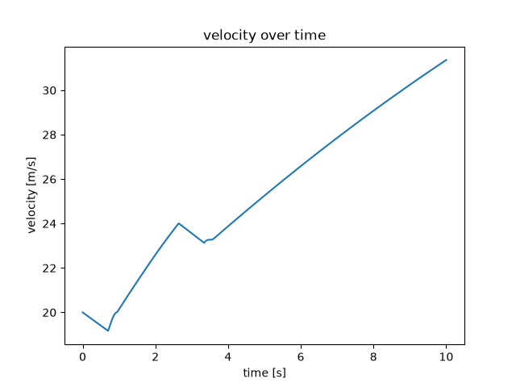
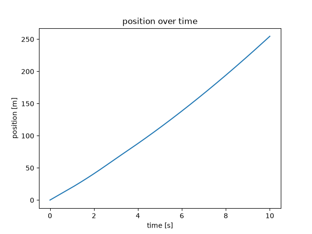

# Vehicle Dynamics

### From physical equations to a longitudinal vehicle simulation

A personal Python project exploring how engine torque, transmission ratios, road resistance and gear changes shape a vehicle's motion over time.

I am developing this project as a Mathematical Engineering student at Politecnico di Milano, with a particular interest in automotive simulation. The aim is to build the model progressively, understand the assumptions behind each component, and translate physical reasoning into working numerical code.

**Current stage:** a working longitudinal vehicle simulator with automatic upshift selection, torque interruption and a simplified clutch engagement model. The program runs from `modello.py` and produces velocity and position histories. Further development focuses on refining the physical model and comparing its results with reference data.

## What the simulation does

- Interpolates engine torque from a discrete torque–RPM curve.
- Converts engine torque into wheel force through a six-speed gearbox, final drive and transmission efficiency.
- Applies a simplified tyre–road traction limit during normal driving.
- Accounts for aerodynamic drag, rolling resistance, road gradient and a constant headwind.
- Selects upshifts by comparing available tractive force in consecutive gears, with an additional 7,500 RPM threshold.
- Represents torque interruption and a finite clutch engagement phase during gear changes.
- Integrates vehicle velocity and position and displays their evolution with Matplotlib.

The current scope is straight-line longitudinal motion. Steering, suspension dynamics, lateral tyre behaviour and CFD are outside the implemented model.

## The first major modelling challenge: the transmission

**The transmission was my first substantial challenge in applying physical modelling to programming.**

The initial force balance provided a relatively direct route from equations to code: calculate the forces, obtain acceleration, and update the vehicle's motion. A gear change introduced a different problem. Changing the numerical gear ratio alone does not describe how torque reaches the wheels while the engine and transmission are being disconnected and reconnected.

Working on this part required me to consider several connected questions:

- What happens to the vehicle while driving torque is interrupted?
- How does the clutch's clamping force develop during engagement?
- How can a friction torque be obtained by integrating over the contact surface?
- How is that torque transmitted through the selected gear to the wheels?
- How should engine speed evolve when it is no longer kinematically tied to vehicle speed?

The current implementation is an intermediate step: it uses a prescribed engagement duration and a friction-based torque calculation. The next physical extension is to introduce engine-side rotational inertia and evolve engine RPM independently during slip, working towards an engagement condition based on synchronisation rather than elapsed time alone.

This part of the project documents the process of choosing assumptions, deriving equations, identifying the limits of an approximation and expressing the resulting model as a sequence of computational steps.

### Supporting calculations and handwritten notes

I am preparing accompanying pages that explain the physical reasoning behind the transmission model:

- **LaTeX calculations:** an organised record of the equations, assumptions and derivations.
- **Handwritten pages:** sketches, intermediate calculations and explanations showing the reasoning behind the model's development.

These materials will accompany the code so that readers can follow both the implementation and the physics that motivated it. They will also distinguish calculations already implemented from work on the next version of the model.

*Documentation status: the LaTeX and handwritten attachments are being added and are not yet included in this snapshot.*

## Example output

Results from the default development scenario described below.





The plots show how acceleration and gear changes affect vehicle velocity and position over time.

## Physical model

### Longitudinal force balance

During normal driving, acceleration follows

$$
m\frac{dv}{dt}=F_{\mathrm{traction}}+F_{\mathrm{drag}}+F_{\mathrm{rolling}}+F_{\mathrm{slope}}.
$$

The resistance terms are implemented as signed forces:

$$
F_{\mathrm{drag}} = -\frac{1}{2}\rho C_d A\,v_{\mathrm{rel}}|v_{\mathrm{rel}}|
$$

$$
F_{\mathrm{rolling}} = -C_{rr}mg\,\mathrm{sgn}(v)
$$

$$
F_{\mathrm{slope}} = -mg\sin\theta
$$

The rolling resistance expression uses a simplified normal load of $mg$. The current wind assumption is $v_{\mathrm{rel}}=v+10\,\mathrm{m/s}$.

### Engine and wheel force

When the drivetrain is treated as fully engaged, engine speed is calculated from vehicle speed:

$$
n_e=\frac{v}{r_w}\,i_g i_d\,\frac{60}{2\pi}.
$$

Engine torque $T_e(n_e)$ is obtained by linear interpolation. During normal driving, the available tractive force is

$$
F_{\mathrm{traction}}=
\min\left(\frac{T_e(n_e)i_g i_d\eta}{r_w},\mu_{\mathrm{road}}mg\right).
$$

Here $i_g$ is the selected gear ratio, $i_d$ the final drive ratio, $\eta$ the transmission efficiency and $r_w$ the wheel radius. The grip limit is a first approximation; axle load distribution and load transfer are not modelled.

The upshift comparison evaluates both gears at the same vehicle speed. It is a local comparison of available wheel force, rather than an optimisation of the complete acceleration trajectory including shift losses.

### Clutch engagement

For the simplified uniform-pressure circular contact surface used in the code, the friction torque expression reduces to

$$
T_c=\frac{2}{3}\mu_c F_s r_f,
\qquad
F_{\mathrm{wheel}}=\frac{T_c i_g i_d\eta}{r_w}.
$$

Clamping force is prescribed with a sinusoidal expression, and engagement is simulated over a 0.25 s interval. This is an experimental approximation: clutch torque capacity is currently used directly as transmitted torque, without a coupled engine–clutch rotational model.

## Run the project

The project uses **Python 3**, **NumPy** and **Matplotlib**. Download or clone the repository, then open a terminal in its root directory, alongside `modello.py`.

Create a virtual environment:

```bash
python -m venv .venv
```

**Windows — PowerShell**

```powershell
.\.venv\Scripts\python.exe -m pip install -r requirements.txt
.\.venv\Scripts\python.exe modello.py
```

**macOS / Linux**

```bash
.venv/bin/python -m pip install -r requirements.txt
.venv/bin/python modello.py
```

The program prints time, tractive force, gear index and engine RPM. It then displays **velocity versus time** and **position versus time**. Depending on the plotting backend, close the first figure to display the second.

Gear indices run from **0 to 5**, corresponding to **first through sixth gear**.

## Default demonstration

The parameters are currently defined directly in `modello.py`.

| Parameter | Default value |
| :--- | ---: |
| Vehicle mass | 1,500 kg |
| Initial speed | 20 m/s (72 km/h) |
| Target simulation duration | 10 s |
| Integration time step | 0.001 s |
| Road gradient | 5° |
| Headwind | 10 m/s |
| Drag coefficient | 0.30 |
| Frontal area | 2.2 m² |
| Rolling resistance coefficient | 0.01 |
| Wheel radius | 0.32 m |
| Final drive ratio | 3.5 |
| Transmission efficiency | 0.90 |
| Torque interruption duration | 0.70 s |
| Clutch engagement duration | 0.25 s |

The torque table spans 1,000–7,500 RPM. The six gear ratios are `5.087`, `2.991`, `2.035`, `1.594`, `1.286` and `1.000`.

These values form a development scenario, not a calibrated specification for a complete production vehicle. The initial gear index is `0`; at the chosen starting speed, this triggers an immediate upshift.

## Code organisation

| Location | Responsibility |
| :--- | :--- |
| `modello.py` | Parameters, main simulation loop and coordination of driving and shift phases |
| `dynamics/resisting_forces/` | Aerodynamic drag, rolling resistance and road gradient |
| `dynamics/traction_managing/` | Engine RPM, interpolated torque and wheel force |
| `dynamics/gear_management/` | Upshift selection, torque interruption and clutch engagement |
| `dynamics/data_managing/` | Force aggregation, time integration, stored histories and plots |

The integration step updates velocity from the current acceleration, then updates position using the new velocity.

## Modelling scope and future development

The current simulation is runnable and includes the driving, torque-interruption and clutch-engagement phases. The following extensions build on that working implementation:

- **Engine and clutch rotational dynamics:** introduce engine-side inertia, evolve engine RPM independently during slip, and determine engagement from synchronisation between the two clutch sides.
- **Vehicle data and calibration:** document the sources of the torque curve and vehicle parameters, and compare simulated results with measured or published reference data.
- **A wider operating range:** extend the model to launch from rest, idle behaviour and more detailed engine operating limits.
- **Numerical verification:** add reproducible reference scenarios and examine sensitivity to the integration time step.

The present model uses simplified physical assumptions, including straight-line motion, a constant transmission efficiency and a prescribed clutch engagement duration. Validation against measured vehicle data remains a future milestone.

## Author

**Domenico Misitano**  
Mathematical Engineering student — Politecnico di Milano

Developed as an independent learning project at the intersection of mechanics, numerical modelling and Python programming, with a long-term interest in automotive simulation.
